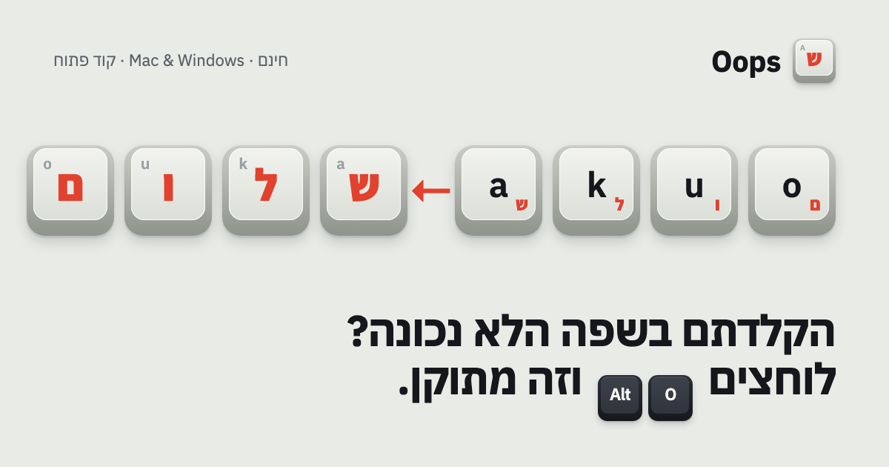

<p align="center"></p>

# Oops

**Typed in the wrong language? Press <kbd>Alt</kbd>+<kbd>O</kbd> (<kbd>⌥</kbd><kbd>O</kbd> on Mac) and it's fixed.**

Oops is a tiny menu-bar / tray app for Mac and Windows. When you type `akuo` because your keyboard was on English but you meant `שלום`, press the shortcut and Oops deletes the gibberish and retypes it in the right language. It works the other way too (`ןמנםס` → `inbox`), in every app.

**[Download and install guide →](https://nadavm-ux.github.io/oops/)**

| | |
|---|---|
| **Mac** | [Oops-mac.dmg](https://github.com/NadavM-ux/oops/releases/latest/download/Oops-mac.dmg) · macOS 11+, Apple Silicon & Intel |
| **Windows** | [Oops-windows-setup.exe](https://github.com/NadavM-ux/oops/releases/latest/download/Oops-windows-setup.exe) · Windows 10/11, no admin needed |
| **One line (Mac)** | `curl -fsSL https://nadavm-ux.github.io/oops/install.sh \| bash` |
| **One line (Windows)** | `irm https://nadavm-ux.github.io/oops/install.ps1 \| iex` |

## What it does

- **Fixes what you just typed.** Only the tail typed in the wrong script changes: in `Hello שלום nv`, just `nv` becomes `מה`.
- **Fixes a selection.** Select any text and press the shortcut to convert exactly that.
- **Undo.** Press the shortcut again right away to put the original back.
- **Switches the keyboard** to the language you were fixing to, so you can keep typing.
- **Your shortcut.** Change it in Settings; it's recorded by pressing the keys.
- Hebrew and English UI, light and dark mode, starts at login, pause from the tray.

No AI, no account, no server. It's a key-by-key mapping of the standard Israeli layout (SI-1452).

## Privacy

To know what to fix, Oops has to see keystrokes. It keeps **at most the last 300 characters, in memory only**, and clears them on every Enter, click, arrow key, shortcut or app switch. Nothing is written to disk and nothing is sent anywhere. The only network request is an optional version check against GitHub's public API (turn it off in Settings). On macOS, password fields are invisible to it by design (Secure Input).

## How it works

```
core/                 Rust library, no UI
  convert.rs          the English ⇄ Hebrew key map and the "what to fix" rules (unit tested)
  engine.rs           keystroke buffer, shortcut detection, fix/undo/selection logic
  platform/macos.rs   CGEventTap, CGEventPost, NSPasteboard, Text Input Sources
  platform/windows.rs WH_KEYBOARD_LL/WH_MOUSE_LL hooks, SendInput, Win32 clipboard
app/                  Tauri 2 app: tray icon, settings & onboarding window (plain HTML/CSS/JS)
website/              the download site (static, deployed to GitHub Pages)
design/               icon, tray, installer and social-image sources (rendered with headless Chrome)
scripts/              asset helpers and the Windows end-to-end test used in CI
```

When you press the shortcut, Oops waits for you to let go of the modifier keys, then:
1. if you just typed something, it sends backspaces for the wrong part and types the converted text as Unicode;
2. otherwise it copies the selection, converts it, pastes it and restores your clipboard (marked so clipboard managers and Windows clipboard history skip it).

## Build it yourself

Requirements: Rust (stable), Node 18+.

```bash
cargo test --workspace            # conversion + engine tests
cd app && npm install
npx tauri dev                     # run with hot reload
npm run build:mac                 # universal .app + .dmg (on a Mac)
npm run build:win                 # NSIS installer (on Windows)
```

Releases are built by GitHub Actions on real Mac and Windows machines when a `v*` tag is pushed; the Windows job also runs an end-to-end test that types into Notepad. The apps are not code-signed (that costs a yearly fee), which is why macOS and Windows show a warning the first time; the install guide walks through it.

---

## בעברית

**הקלדתם בשפה הלא נכונה? לוחצים Alt+O (‏⌥O ב־Mac) וזה מתוקן.**

Oops הוא אפליקציה קטנה ל־Mac ול־Windows שיושבת בשורת התפריטים / ליד השעון. כתבתם `akuo` כי המקלדת הייתה על אנגלית והתכוונתם ל־`שלום`? לוחצים על הקיצור ו־Oops מוחק את הג׳יבריש ומקליד אותו מחדש בשפה הנכונה. עובד גם הפוך, בכל אפליקציה.

- מתקן רק את מה שהוקלד בשפה הלא נכונה; סימנתם טקסט? מתקן בדיוק אותו.
- לחיצה נוספת מבטלת.
- מחליף את שפת המקלדת בשבילכם.
- בלי AI, בלי שרת, בלי חשבון. זוכר רק את המילים האחרונות, בזיכרון בלבד.

**[הורדה והוראות התקנה ←](https://nadavm-ux.github.io/oops/)**

Made by [@nadav.tech_](https://www.instagram.com/nadav.tech_/) · MIT License
